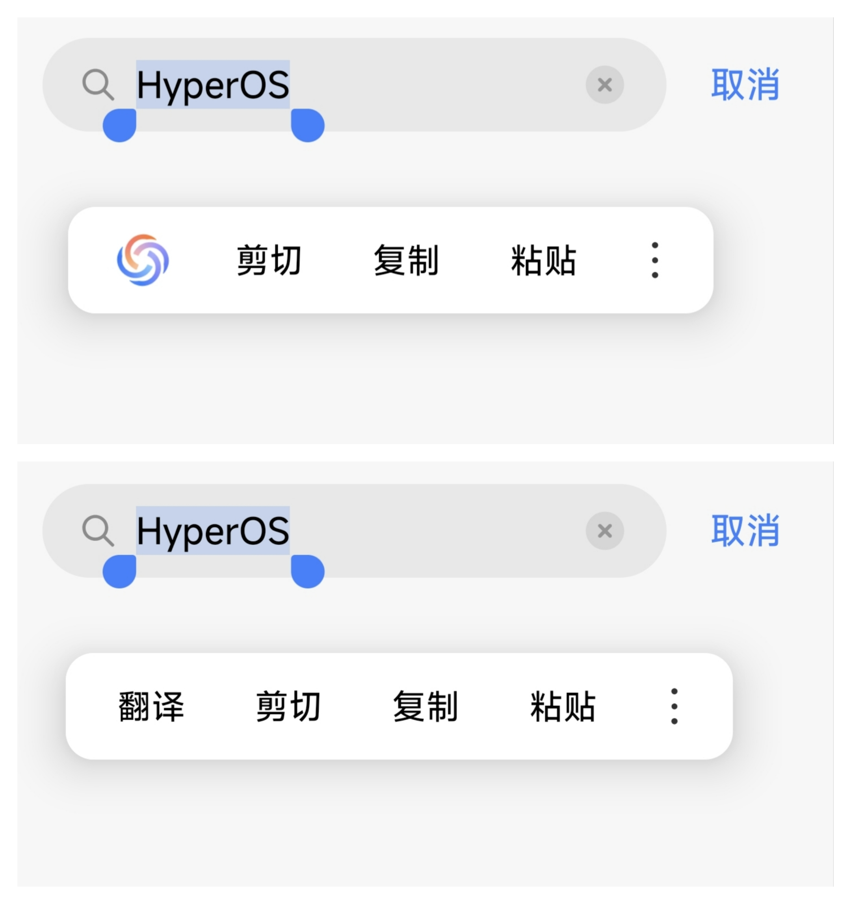
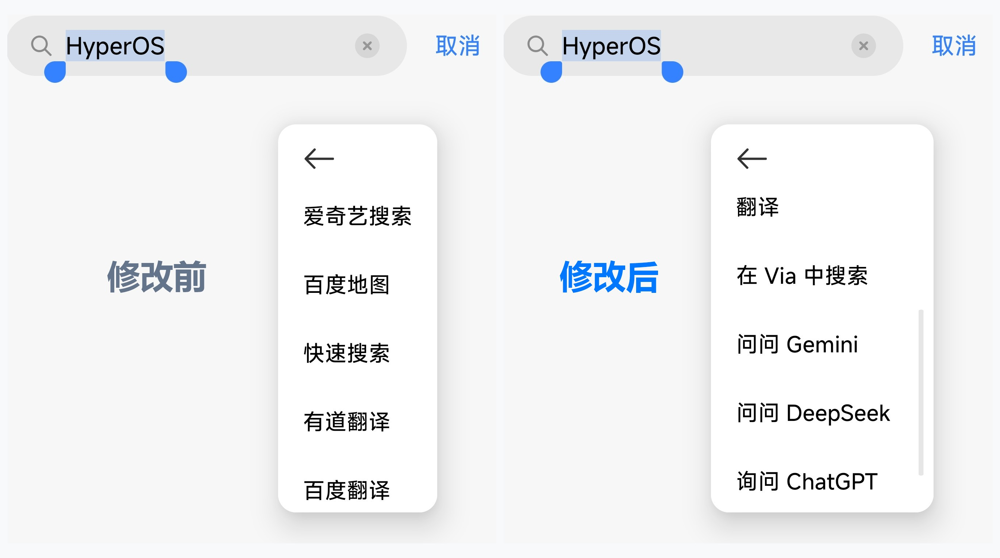

# HyperSelect

适用于小米澎湃系统（Xiaomi HyperOS）的文本菜单、系统分享与打开方式净化模块。

---

## 特性

- **移除 AI 写作**：彻底去掉选词栏首位的 AI 写作小圆圈
- **选词菜单管理**：在应用内自由拖拽排序、滑动隐藏选项
- **分享与打开方式**：高频应用常驻置顶，隐藏冷门选项
- **即时生效**：规则修改无需重启手机，即改即用

---

## 效果预览

  

  

  

---

## 运行环境

- **系统**：Xiaomi HyperOS 2.0 / OS 3（理论兼容 1.0+）
- **框架**：LSPosed（基于 LibXposed API 102）
- **作用域**：`system` 与 `com.android.intentresolver`

---

## 开源协议

[GNU General Public License v3.0](LICENSE)
